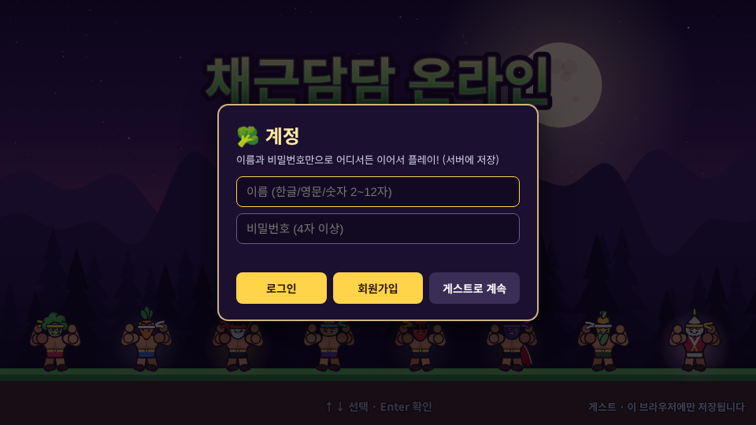
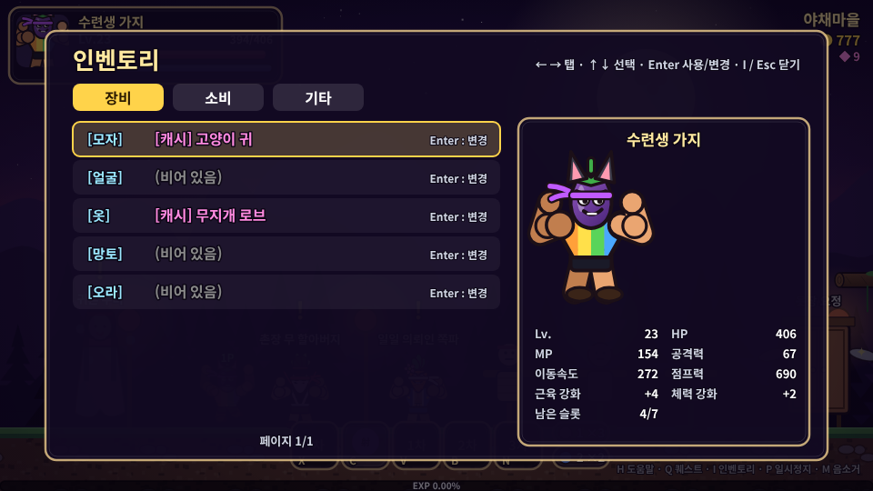
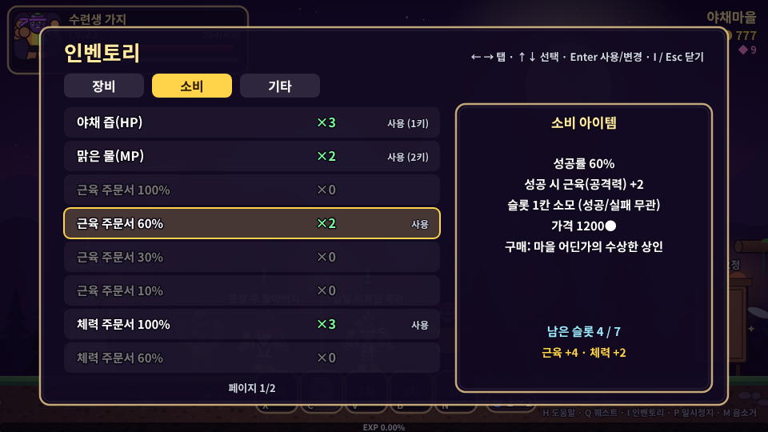
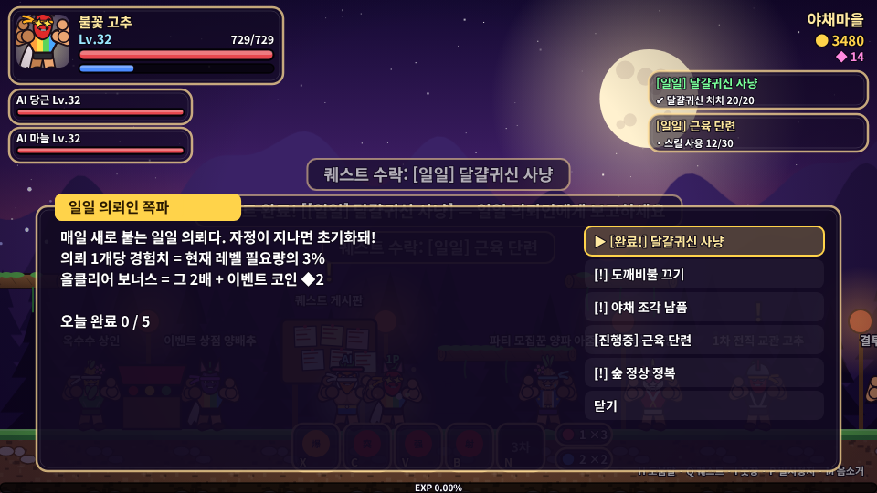
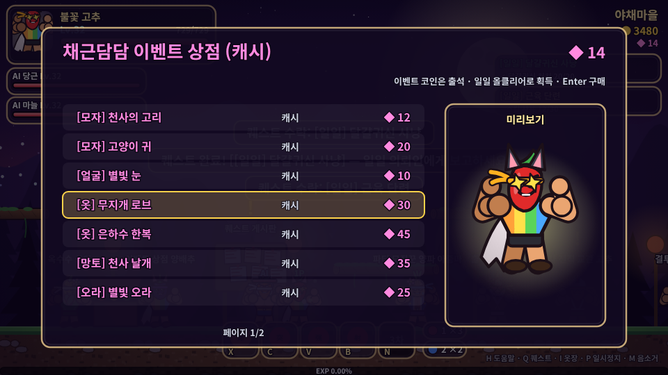
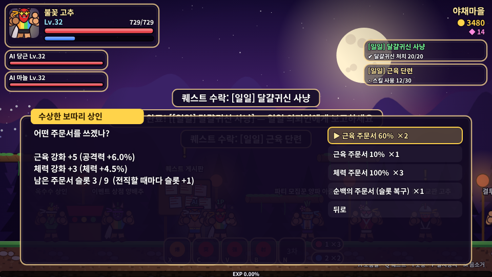
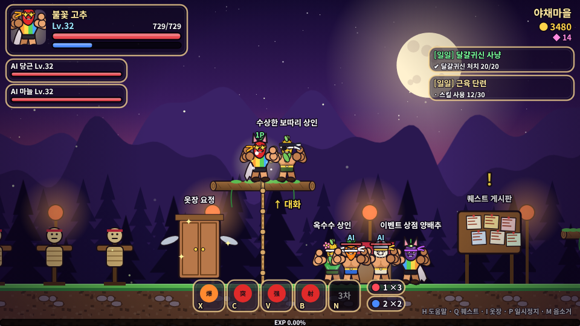
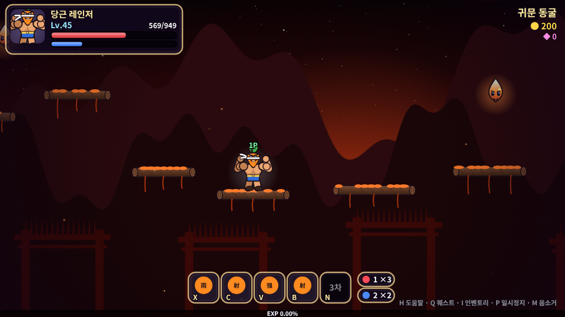
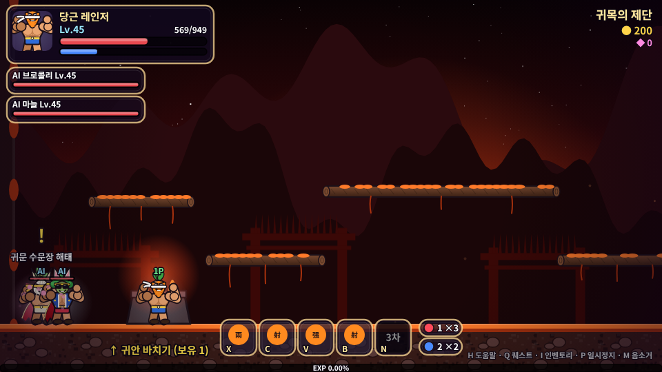
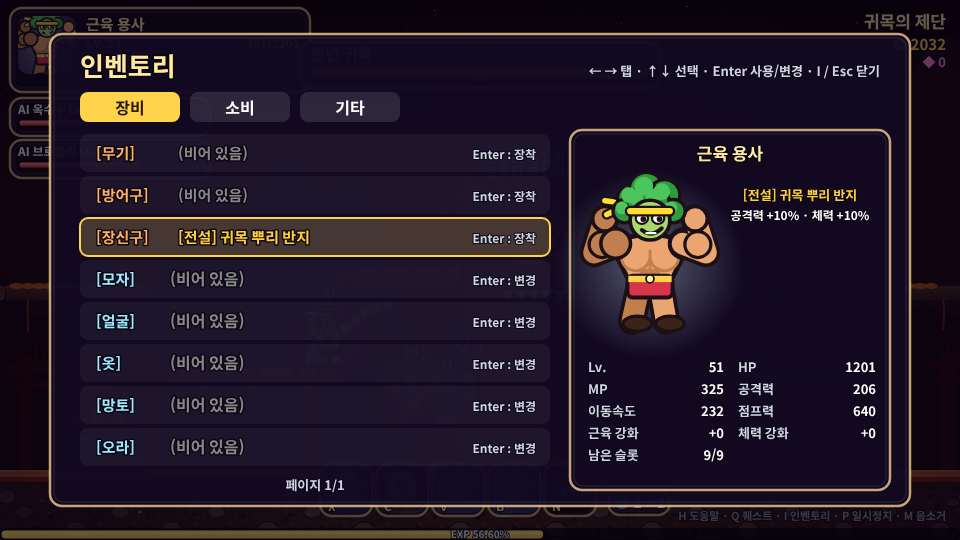

# 🥦 채근담담 온라인 : 귀혼의 숲

> 근육 야채 용사들이 도깨비·귀신이 사는 숲을 오르는 **웹 2D 점프맵 액션 RPG**.
> 설치 없이 브라우저에서 바로 실행되는 **단일 HTML 파일**(Canvas, 외부 에셋 0개 — 그림과 소리 모두 코드로 생성)입니다.


## ▶ 바로 플레이

- **Render 배포 주소**: _(배포 후 여기에 URL을 적어주세요)_
- 로컬 실행: `index.html` 을 브라우저로 열면 게스트(로컬 저장)로 바로 플레이 · 계정 저장까지 쓰려면 `npm install && npm start` (아래 참고)

## ✨ 특징

| | |
|---|---|
| 🎮 | 메이플스토리식 점프맵 (밧줄 · 한 방향 발판 · 움직이는/부서지는 발판 · 가시 · 낙석 장승 · 체크포인트) |
| 👹 | 패턴 보스 3종 (도깨비 대왕 · 구미호 · 달걀귀신 대왕) — 경고 구역을 보고 피하는 방식 |
| 🧑‍🤝‍🧑 | 파티퀘스트 "달걀귀신 소굴" 4단계 (로컬 2P + AI 동료) |
| 🥕 | 8개 직업 · 수련생→1차→2차→3차 전직 (전직 장소가 모두 다름) |
| ⚔️ | 낙사 결투장 PvP + 넉백 |
| 💾 | 이름+비밀번호 계정 · 서버(DB) 저장 — 어느 기기에서든 이어하기 |
| 🎒 | 인벤토리 창(장비 · 소비 · 기타) |
| 🌋 | 자쿰식 파티던전: 용암 점프맵 → 퀘스트 전용 소환템 → 팔 8개 보스 '천년 귀목' |
| 🗡 | 능력치 장비(무기·방어구·장신구) 5등급 — 등급이 높을수록 드랍률↓, 최고 등급은 퀘스트 전용 |
| 📅 | 일일 퀘스트 · 출석 체크 · 이벤트 코인 · 캐시 치장 상점 · 숨은 주문서 상인 |

## 🕹 조작법

| 키 | 동작 |
|---|---|
| ← → | 이동 |
| Space / Alt | 점프 (↓ + 점프 = 아래 발판으로 내려가기) |
| Z / Ctrl | 공격 |
| C | 수련생 스킬 |
| X · V | 1차 스킬 |
| B · N | 2차 · 3차 스킬 |
| ↑ | 밧줄 오르기 · NPC 대화 · 포탈 입장 |
| 1 / 2 | HP / MP 물약 |
| Q · I · E · P · M · H | 퀘스트 · 옷장 · AI 동료 대기 · 일시정지 · 음소거 · 도움말 |
| 2P (WASD · Shift · F · G H T Y U) | 같은 키보드에서 2인 플레이 |

## 💾 계정 & 저장 (DB)

타이틀의 **로그인 / 회원가입**에서 *이름 + 비밀번호*만으로 계정을 만들면 진행 상황이 서버 DB(Postgres)에 저장되어 다른 기기·브라우저에서도 이어서 할 수 있습니다. 서버가 없거나 로그인하지 않으면 **게스트**로 이 브라우저에만 저장됩니다(게스트 저장은 가입 시 계정으로 자동 이전).



- 비밀번호는 scrypt + 솔트로 해시해 저장 (원문 저장 안 함), 로그인 토큰은 HMAC 서명(30일)
- 이름 2~12자(한글/영문/숫자/_), 비밀번호 4자 이상, IP별 요청 제한

## 🎒 인벤토리 (I 키)

장비 탭(착용 치장 5슬롯 + 능력치), 소비 탭(물약 · 강화 주문서 사용), 기타 탭(재료 · 재화 · 기록).




## 🥬 직업 8종

브로콜리 전사 · 당근 궁수 · 무 수호자 · 양파 마법사 · 고추 화염 격투가 · 가지 암살자 · 옥수수 팝콘 거너 · 마늘 성직자


## 🏘 야채마을 (허브)

촌장 · 일일 의뢰인 · 옷장 요정 · 상점 · 이벤트 상점 · 게시판 · 파티 모집꾼 · 출석부 요정 · 전직 교관 · 결투장 심판 · 포탈 지기가 모여 있습니다.


## 📈 레벨 · 경험치 (만렙 100)

| 구간 | 느낌 | 레벨업에 필요한 사냥 횟수(대략) |
|---|---|---|
| Lv 1 ~ 10 | 매우 빠름 | 8 ~ 10 |
| Lv 10 ~ 30 | 완만 | 20 → 80 |
| Lv 30 ~ 50 | 어려움 | 80 → 240 |
| Lv 50 ~ 70 | 매우 어려움 | 240 → 450 |
| **Lv 70 ~** | **거의 안 오름** | **1,800+** |

퀘스트·일일퀘스트·보스 보상은 "현재 레벨 필요량의 %"라서 고레벨에서는 **일일 퀘스트**가 주 경험치원입니다.

## 🎓 전직 (장소가 다릅니다)

| 전직 | 레벨 | 장소 | 시험 |
|---|---|---|---|
| 1차 | 10 | 야채마을 · 전직 교관 고추 | 몬스터 20마리 + 스킬 10회 |
| 2차 | 30 | 도깨비 숲 꼭대기 · 숲의 스승 | 시련 도깨비 대왕(체력 ×1.6) + 야채 조각 15 |
| 3차 | 70 | 하늘길 끝 달빛 신당 · 달빛 대현자 | 시련 구미호(체력 ×1.6) + 야채 조각 30 |

## 📅 일일 퀘스트 · 출석 · 이벤트 코인

매일 자정에 초기화되는 일일 퀘스트 5종, 올클리어하면 보너스 경험치와 이벤트 코인 ◆2.



**출석부**: 매일 도장을 찍어 ◆ 이벤트 코인을 받고, **7일 연속 출석하면 캐시 치장템**을 줍니다(하루라도 빠지면 처음부터). 누적 10/20/30/50/100일 보너스도 있습니다.


**이벤트 상점**: 캐시 치장(날개 망토, 무지개 로브, 별빛 오라 등)은 **◆ 이벤트 코인으로만** 살 수 있습니다. 일반 상점이나 드롭으로는 얻을 수 없어요.



## 📜 숨은 주문서 상인

마을 밧줄 위 발판에 수상한 보따리 상인이 숨어 있습니다(가까이 가야 모습이 드러남, 촌장이 힌트를 줍니다).
슬롯(7칸 + 전직 단계) 1칸을 소모해 근육/체력을 강화하는 주문서를 ● 코인으로 팝니다. 성공 확률은 100/60/30/10%, 순백의 주문서는 슬롯을 복구합니다.




## 🏔 점프맵 · 👹 보스


## 🌋 파티던전 — 귀문 동굴 → 천년 귀목 (Lv.40+)

메이플 자쿰 원정을 참고한 3단계 구성입니다. 마을 포탈 지기(마늘 스님) → **귀문 동굴**.

| 단계 | 내용 | 보상 |
|---|---|---|
| 1. 숨겨진 길 | 용암 위 40구간 점프맵(부서지는/움직이는 발판, 가시, 낙석, 떨어지면 피해) 끝까지 돌파 | **[전설] 귀문 수련자의 팔찌** (퀘스트 전용) |
| 2. 귀안 만들기 (반복) | 동굴 몬스터가 **20%** 확률로 떨어뜨리는 도깨비 금이빨 ×8 납품 | 소환템 **귀안(鬼眼)** — 이 퀘스트로만 획득 |
| 3. 귀목 토벌대 | 천년 귀목 3회 처치 + 보스가 **40%** 확률로 남기는 귀목의 정수 ×3 | **[신화] 천년 귀목 투구** (퀘스트 전용, 최고 성능) |

**귀목의 제단**은 2인 이상 파티 던전입니다(로컬 2P 또는 AI 동료). 제단에 귀안을 바치면 천년 귀목이 깨어나며, **팔 8개를 모두 부숴야 본체에 피해**가 들어갑니다. 팔 내려찍기 · 뿌리 기둥 · 종유석 낙하 · 불씨 탄막 · 충격파 · 도깨비불 소환 패턴이 있습니다.





## 🗡 장비 (인벤토리 → 장비 탭)

| 등급 | 장비 | 얻는 곳 (확률) | 능력치 |
|---|---|---|---|
| 일반 | 수련용 나무막대 | 도깨비 대왕 25% | 공격 +3% |
| 희귀 | 도깨비 방망이 | 도깨비 대왕 10% | 공격 +7% |
| 희귀 | 달걀 껍질 갑옷 | 달걀귀신 대왕 15% | 체력 +10% |
| 영웅 | 여우 구슬 목걸이 | 구미호 7% | 공격 +6%, MP +12% |
| 영웅 | 귀목 몽둥이 / 귀목 껍질 갑옷 | 천년 귀목 10% / 10% | 공격 +13% / 체력 +18% 공격 +3% |
| 전설 | 귀목 뿌리 반지 | 천년 귀목 **2.5%** | 공격 +10%, 체력 +10% |
| 전설 | 천년 귀목의 심장검 | 천년 귀목 **1%** | 공격 +22% |
| 전설 | 귀문 수련자의 팔찌 | **퀘스트 전용** | 공격 +9%, 체력 +9%, 이동 +3% |
| **신화** | **천년 귀목 투구** | **퀘스트 전용** | 공격 +16%, 체력 +32%, MP +15%, 이동 +5% |



## ⚔️ PvP — 낙사 결투장

1P vs 2P(로컬) 또는 AI 도전자. 피해가 클수록·체력이 적을수록 **더 멀리 밀려나고**, 섬 밖으로 떨어지면 상대 1점. 3KO 선취!


## 🛠 개발

소스는 `head.html` + `parts/01~09_*.js` + `tail.html` 이며, `build.sh` 가 이를 합쳐 단일 `index.html` 을 만듭니다. 계정 API 서버는 `server/` (Express + Postgres).

```bash
./build.sh                       # index.html 생성 + 문법 검사
npm install
npm start                        # http://localhost:3000  (DATABASE_URL 없으면 data/db.json 파일 DB 사용)
npm run test:server              # 계정/저장 API 통합 테스트
pip install playwright && python3 tests/test_progression_pvp.py   # (선택) 게임 시뮬레이션 테스트
```

| 파일 | 내용 |
|---|---|
| `parts/01_core.js` | 입력 · WebAudio 합성 사운드/BGM · 파티클 |
| `parts/02_art.js`, `04_art2.js` | 모든 그래픽(벡터 드로잉) · 캐릭터/치장/NPC |
| `parts/03_data.js` | 직업 · 스킬 · 치장 · 퀘스트 · 경험치 곡선 · 저장/계정 클라이언트 |
| `parts/05_world.js` | 마을 · 점프맵(시드 생성) · 보스방 · 파티퀘스트 · PvP 맵 |
| `parts/06_entities.js` | 전투 · 스킬 · 몬스터 · PvP · AI 동료 |
| `parts/07_boss.js` | 보스 AI(제너레이터 스크립트) |
| `parts/08_ui.js` | 퀘스트 · 대화 · 상점 · 인벤토리 · 출석 · 주문서 · HUD |
| `parts/09_main.js` | 게임 루프 · 맵 로딩 · 렌더 |
| `server/server.js`, `db.js` | 계정/저장 API · Postgres(Neon)/파일 DB 어댑터 |

### ☁️ 배포: Render(웹) + Neon(무료 Postgres)

1. **Neon**: [neon.com](https://neon.com) 에서 프로젝트 생성 → *Connection string* 복사 (`postgresql://…?sslmode=require`). 테이블은 서버가 첫 실행 때 자동 생성합니다.
2. **Render**: 이 저장소를 연결해 **New → Blueprint** (루트의 `render.yaml` 사용) 또는 **New → Web Service** (Build `npm install`, Start `npm start`).
3. 환경변수 `DATABASE_URL` 에 Neon 연결 문자열을 넣고, `SECRET` 은 자동 생성(Blueprint) 또는 임의의 긴 문자열로 설정.
4. 이후 `main` 에 푸시하면 자동 배포됩니다. 헬스체크: `/api/health`

> Neon 무료 플랜은 유휴 시 DB가 절전되어 첫 로그인이 1~2초 느릴 수 있고, Render 무료 웹 서비스도 유휴 후 첫 접속이 느립니다.

## 알려진 한계

- 온라인 **실시간** 멀티플레이는 불가 — 로컬 2P + AI 동료로 대체 (계정/저장만 서버)
- 몬스터가 레벨에 맞춰 강해지지 않아 고레벨은 쉬워짐
- 저장 데이터는 클라이언트가 보내므로 변조 방지는 하지 않음 (캐주얼 용도)
