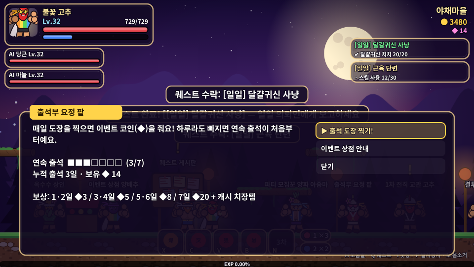
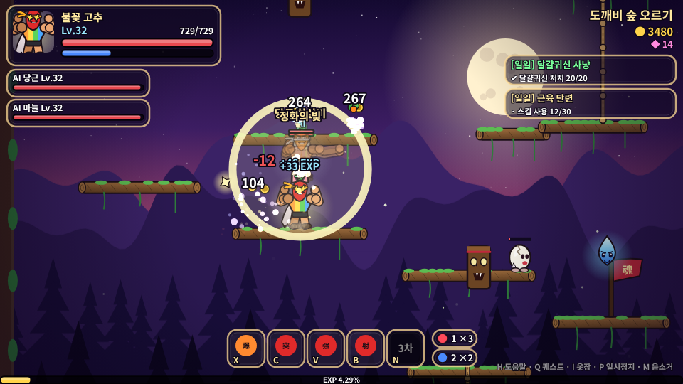
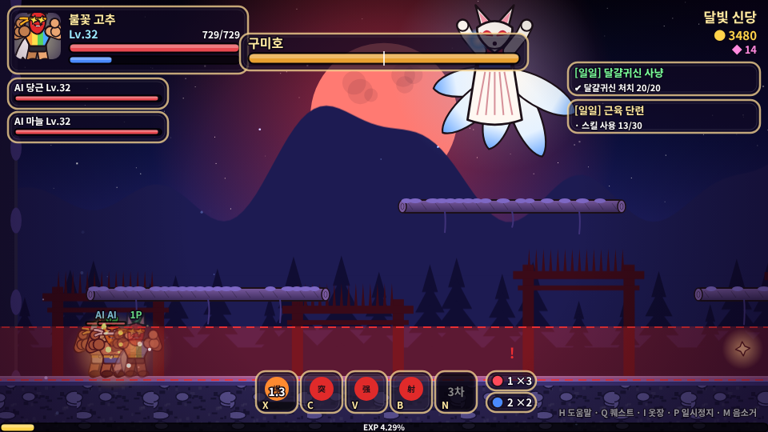
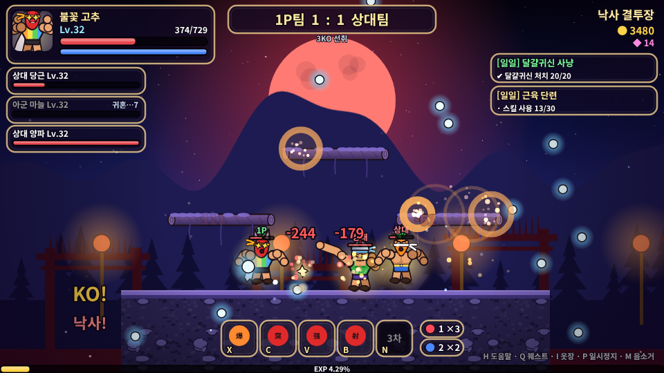

# 🥦 채근담담 온라인 : 귀혼의 숲

> 근육 야채 용사들이 도깨비·귀신이 사는 숲을 오르는 **웹 2D 점프맵 액션 RPG**.
> 설치 없이 브라우저에서 바로 실행되는 **단일 HTML 파일**(Canvas, 외부 에셋 0개 — 그림과 소리 모두 코드로 생성)입니다.


## ▶ 바로 플레이

- **Render 배포 주소**: _(배포 후 여기에 URL을 적어주세요)_
- 로컬 실행: `index.html` 을 브라우저로 열면 끝 (서버 불필요)

## ✨ 특징

| | |
|---|---|
| 🎮 | 메이플스토리식 점프맵 (밧줄 · 한 방향 발판 · 움직이는/부서지는 발판 · 가시 · 낙석 장승 · 체크포인트) |
| 👹 | 패턴 보스 3종 (도깨비 대왕 · 구미호 · 달걀귀신 대왕) — 경고 구역을 보고 피하는 방식 |
| 🧑‍🤝‍🧑 | 파티퀘스트 "달걀귀신 소굴" 4단계 (로컬 2P + AI 동료) |
| 🥕 | 8개 직업 · 수련생→1차→2차→3차 전직 (전직 장소가 모두 다름) |
| ⚔️ | 낙사 결투장 PvP + 넉백 |
| 📅 | 일일 퀘스트 · 출석 체크 · 이벤트 코인 · 캐시 치장 상점 · 숨은 주문서 상인 |

## 🕹 조작법

| 키 | 동작 |
|---|---|
| ← → | 이동 |
| Space / Alt | 점프 (↓ + 점프 = 아래 발판으로 내려가기) |
| Z / Ctrl | 공격 |
| C | 수련생 스킬 |
| X · V | 1차 스킬 |
| B · N | 2차 · 3차 스킬 |
| ↑ | 밧줄 오르기 · NPC 대화 · 포탈 입장 |
| 1 / 2 | HP / MP 물약 |
| Q · I · E · P · M · H | 퀘스트 · 옷장 · AI 동료 대기 · 일시정지 · 음소거 · 도움말 |
| 2P (WASD · Shift · F · G H T Y U) | 같은 키보드에서 2인 플레이 |

## 🥬 직업 8종

브로콜리 전사 · 당근 궁수 · 무 수호자 · 양파 마법사 · 고추 화염 격투가 · 가지 암살자 · 옥수수 팝콘 거너 · 마늘 성직자


## 🏘 야채마을 (허브)

촌장 · 일일 의뢰인 · 옷장 요정 · 상점 · 이벤트 상점 · 게시판 · 파티 모집꾼 · 출석부 요정 · 전직 교관 · 결투장 심판 · 포탈 지기가 모여 있습니다.


## 📈 레벨 · 경험치 (만렙 100)

| 구간 | 느낌 | 레벨업에 필요한 사냥 횟수(대략) |
|---|---|---|
| Lv 1 ~ 10 | 매우 빠름 | 8 ~ 10 |
| Lv 10 ~ 30 | 완만 | 20 → 80 |
| Lv 30 ~ 50 | 어려움 | 80 → 240 |
| Lv 50 ~ 70 | 매우 어려움 | 240 → 450 |
| **Lv 70 ~** | **거의 안 오름** | **1,800+** |

퀘스트·일일퀘스트·보스 보상은 "현재 레벨 필요량의 %"라서 고레벨에서는 **일일 퀘스트**가 주 경험치원입니다.

## 🎓 전직 (장소가 다릅니다)

| 전직 | 레벨 | 장소 | 시험 |
|---|---|---|---|
| 1차 | 10 | 야채마을 · 전직 교관 고추 | 몬스터 20마리 + 스킬 10회 |
| 2차 | 30 | 도깨비 숲 꼭대기 · 숲의 스승 | 시련 도깨비 대왕(체력 ×1.6) + 야채 조각 15 |
| 3차 | 70 | 하늘길 끝 달빛 신당 · 달빛 대현자 | 시련 구미호(체력 ×1.6) + 야채 조각 30 |

## 📅 일일 퀘스트 · 출석 · 이벤트 코인

매일 자정에 초기화되는 일일 퀘스트 5종, 올클리어하면 보너스 경험치와 이벤트 코인 ◆2.


**출석부**: 매일 도장을 찍어 ◆ 이벤트 코인을 받고, **7일 연속 출석하면 캐시 치장템**을 줍니다(하루라도 빠지면 처음부터). 누적 10/20/30/50/100일 보너스도 있습니다.



**이벤트 상점**: 캐시 치장(날개 망토, 무지개 로브, 별빛 오라 등)은 **◆ 이벤트 코인으로만** 살 수 있습니다. 일반 상점이나 드롭으로는 얻을 수 없어요.


## 📜 숨은 주문서 상인

마을 밧줄 위 발판에 수상한 보따리 상인이 숨어 있습니다(가까이 가야 모습이 드러남, 촌장이 힌트를 줍니다).
슬롯(7칸 + 전직 단계) 1칸을 소모해 근육/체력을 강화하는 주문서를 ● 코인으로 팝니다. 성공 확률은 100/60/30/10%, 순백의 주문서는 슬롯을 복구합니다.


## 🏔 점프맵 · 👹 보스




## ⚔️ PvP — 낙사 결투장

1P vs 2P(로컬) 또는 AI 도전자. 피해가 클수록·체력이 적을수록 **더 멀리 밀려나고**, 섬 밖으로 떨어지면 상대 1점. 3KO 선취!



## 🛠 개발

소스는 `head.html` + `parts/01~09_*.js` + `tail.html` 이며, `build.sh` 가 이를 합쳐 단일 `index.html` 을 만듭니다.

```bash
./build.sh                 # index.html 생성 + 문법 검사 (Node 필요)
pip install playwright     # (선택) 시뮬레이션 테스트
python3 tests/test_progression_pvp.py
python3 tests/test_attendance_cash_scrolls.py
```

| 파일 | 내용 |
|---|---|
| `parts/01_core.js` | 입력 · WebAudio 합성 사운드/BGM · 파티클 |
| `parts/02_art.js`, `04_art2.js` | 모든 그래픽(벡터 드로잉) · 캐릭터/치장/NPC |
| `parts/03_data.js` | 직업 · 스킬 · 치장 · 퀘스트 · 경험치 곡선 · 저장 |
| `parts/05_world.js` | 마을 · 점프맵(시드 생성) · 보스방 · 파티퀘스트 · PvP 맵 |
| `parts/06_entities.js` | 전투 · 스킬 · 몬스터 · PvP · AI 동료 |
| `parts/07_boss.js` | 보스 AI(제너레이터 스크립트) |
| `parts/08_ui.js` | 퀘스트 · 대화 · 상점 · 옷장 · 출석 · 주문서 · HUD |
| `parts/09_main.js` | 게임 루프 · 맵 로딩 · 렌더 |

### ☁️ Render 배포

저장소 루트의 `render.yaml`(Blueprint)이 정적 사이트로 배포합니다. Render 대시보드 → **New → Blueprint** → 이 저장소 선택. 또는 **New → Static Site** 에서 Build Command 비움, Publish Directory `.` 로 설정해도 됩니다.

## 알려진 한계

- 온라인 멀티플레이는 불가 (단일 정적 사이트) — 로컬 2P + AI 동료로 대체
- 몬스터가 레벨에 맞춰 강해지지 않아 고레벨은 쉬워짐
- 저장은 브라우저 `localStorage`
