# 🥕 채근담담 온라인

> 메이플스토리풍 **2등신 캐릭터**가 **야채 무기**를 들고 떠나는 웹 2D 점프맵 액션 RPG.
> 화면 확대(핀치 · 더블탭 · 더블클릭 · Ctrl+휠)는 막아 두었습니다.
> 설치 없이 브라우저에서 실행되며, 그림과 소리는 모두 코드로 생성합니다(외부 에셋 0개).
> 계정·저장·채팅·운영자 이벤트는 Node 서버와 Postgres(Neon)로 동작합니다.


## ▶ 플레이

- **배포 주소**: <https://chaegeundamdam-online.onrender.com> (무료 서버라 첫 접속 시 최대 1분 정도 깨어나는 시간이 걸립니다)
- 로컬: `npm install && npm start` 후 <http://localhost:3000>
- `index.html`만 열어도 게스트(오프라인)로 플레이할 수 있습니다. 이때 채팅과 이벤트는 꺼집니다.

## ✨ 한눈에 보기

| | |
|---|---|
| ⛵ | 시작 섬 **새싹 항구**: 튜토리얼과 사냥을 하고 Lv.5에 배를 타고 야채마을로 갑니다 |
| 😜 | 표정 20종(방긋 · 윙크 · 멍~ · 하트뿅 · 어질어질 · 메롱 …). NPC와 동료도 표정이 제각각입니다 |
| 👑 | **명예의 전당**(랭킹 표지판). 랭킹 1~3위가 접속하면 전체 환영 알림이 뜹니다 |
| 🧑 | 메이플풍 2등신 캐릭터 8직업. 무기는 모두 야채입니다(대파 검, 당근 활, 무 망치, 양파 지팡이, 고추 너클, 가지 단검, 옥수수 총, 마늘 완드) |
| 📈 | 만렙 100. 레벨당 **AP 5**를 STR·DEX·INT·LUK에 직접 분배합니다 |
| 🗡 | 장비 7칸(오른손 · 왼손 · 방어구 · 장신구 4칸). 양손무기, 직업별 무기, 능력치 착용 조건이 있습니다 |
| 🪨 | **비석의 길**: 옴니버스 스토리 6화. 던전을 깨면 "비석이 뚫렸습니다!"와 함께 다음 지역이 열립니다 |
| 💬 | 채팅(맵) · 확성기(전체) · 고확성기(전체 + 상단 알림) |
| 🎉 | 운영자가 여는 경험치/드롭 2배 이벤트를 접속자 전원이 실시간으로 받습니다 |
| 🌋 | 자쿰식 파티던전(점프맵 → 퀘스트 전용 소환템 → 팔 8개 보스) |
| ⚔️ | PvP 낙사 결투장(넉백) · 일일퀘스트 · 7일 출석 · 캐시 상점 · 강화 주문서 |
| 💾 | 이름 + 비밀번호 계정. 진행은 서버 DB에 저장되어 어느 기기에서나 이어할 수 있습니다 |

## 🕹 조작법

| 키 | 동작 |
|---|---|
| ← → / ↑ ↓ | 이동 / 밧줄 · NPC 대화 · 포탈 · 비석 |
| Space · Alt | 점프 (↓ + 점프 = 아래 발판으로) |
| Z · Ctrl | 공격 |
| C / X V / B / N | 스킬 (수련생 / 1차 / 2차 / 3차) |
| **Enter** | 채팅 (일반 · 확성기 · 고확성기) |
| **O** | 능력치(AP) 분배 |
| I | 인벤토리 (장비 · 소비 · 기타) |
| Q · P · M · H | 퀘스트 · 일시정지 · 음소거 · 도움말 |
| 1 / 2 | HP / MP 물약 |
| 2P | WASD · Shift 점프 · F 공격 · G H T Y U 스킬 (같은 키보드) |

## ⛵ 시작 섬 — 새싹 항구 (Lv.1~5)

새 캐릭터는 파도 소리가 들리는 작은 항구에서 시작합니다. 이 맵은 등대, 부두, 범선, 갈매기, 꽃길로 꾸몄습니다.
- 선장 감자수염의 튜토리얼로 이동, 점프, 공격, 스킬, 밧줄을 배웁니다.
- 해변의 달걀 슬라임 사냥, 반짝 조개 줍기, 빵 배달 퀘스트를 합니다.
- **Lv.5**가 되면 오른쪽 부두의 ⛵ 배를 타고 야채마을(본편)로 갑니다. 마을의 포탈 지기를 통해 항구로 돌아갈 수도 있습니다.

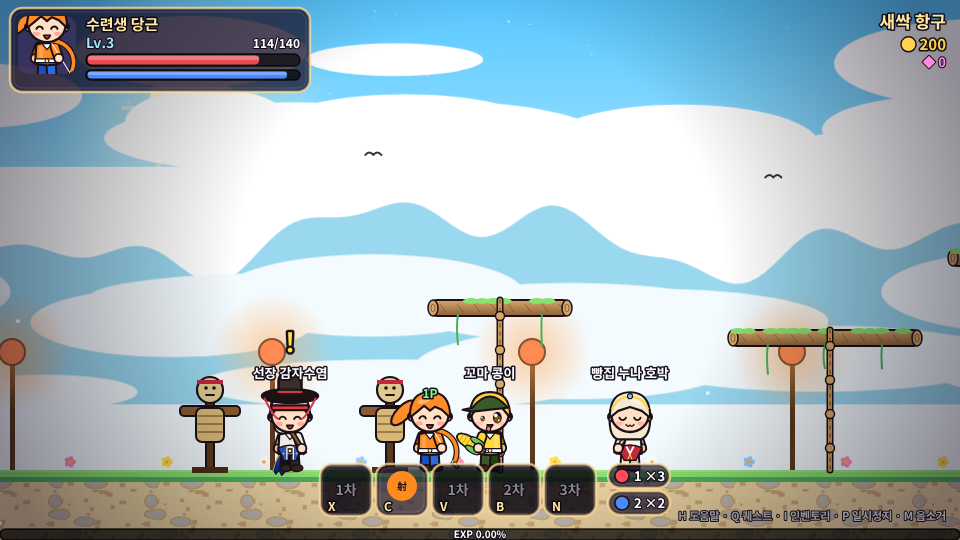
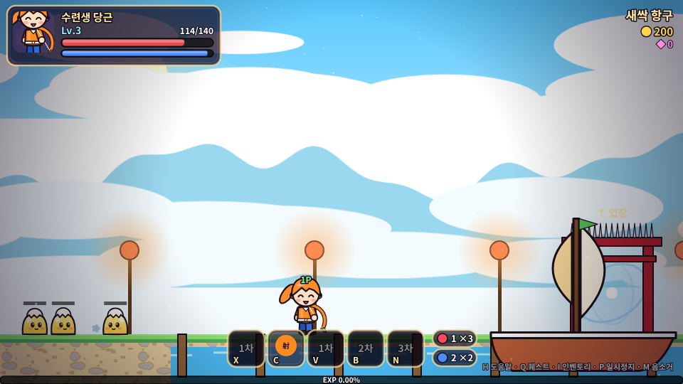

## 😜 표정 20종

캐릭터를 만들 때 **F 키**로 표정을 고르고, 이후에는 **옷장 요정**에게서 바꿀 수 있습니다. 맞으면 잠깐 ✕✕ 표정이 됩니다.


## 👑 명예의 전당 · 랭커 환영

- 야채마을의 **명예의 전당 표지판**(↑)에서 레벨·경험치 기준 상위 10명과 내 순위를 볼 수 있습니다.
- **랭킹 1 · 2 · 3위가 접속하면** 접속 중인 모든 유저에게 금색 환영 알림이 고확성기처럼 뜹니다. 같은 사람은 10분에 한 번만 알립니다.

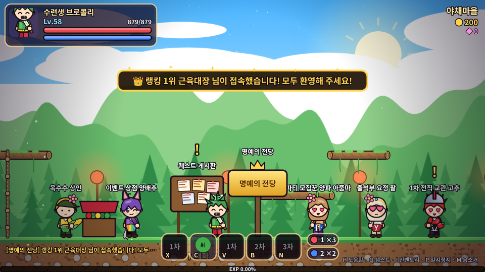
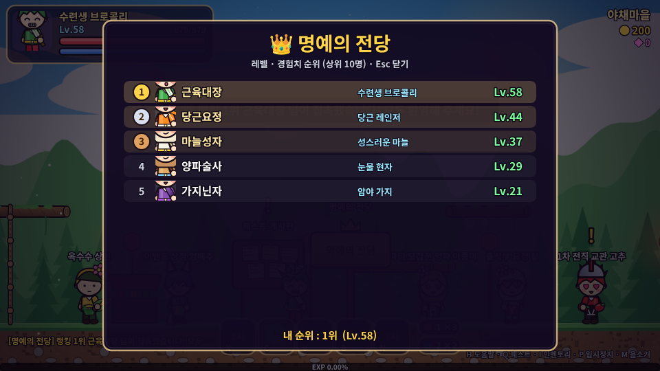

## 🧑 직업 8종과 야채 무기

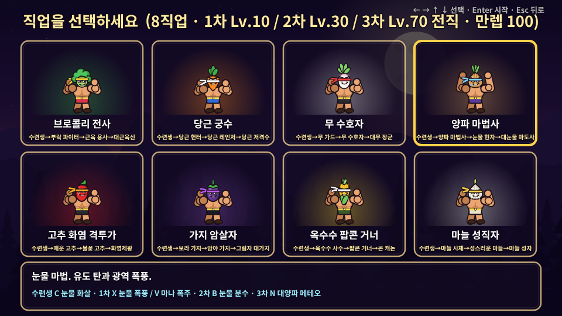

| 직업 | 무기 | 주 능력치 | 쓸 수 있는 무기 (왼손) |
|---|---|---|---|
| 브로콜리 전사 | 대파 검 | STR | 한손검 · 양손검 (방패) |
| 무 수호자 | 무 망치 | STR | 한손검 · 양손검 (방패) |
| 고추 화염 격투가 | 고추 너클 | STR | 너클 |
| 당근 궁수 | 당근 활 | DEX | 활 (양손) |
| 옥수수 팝콘 거너 | 옥수수 총 | DEX | 총 (양손) |
| 양파 마법사 | 양파 지팡이 | INT | 스태프(양손) · 완드 (마도서) |
| 마늘 성직자 | 마늘 완드 | INT | 완드 · 스태프 (방패 · 마도서) |
| 가지 암살자 | 가지 단검 | LUK | 단검 (보조 단검) |

전직은 수련생 → 1차 **Lv.10**(야채마을) → 2차 **Lv.30**(도깨비 숲 꼭대기) → 3차 **Lv.70**(하늘길 끝) 순서입니다. 전직 장소는 단계마다 다릅니다.

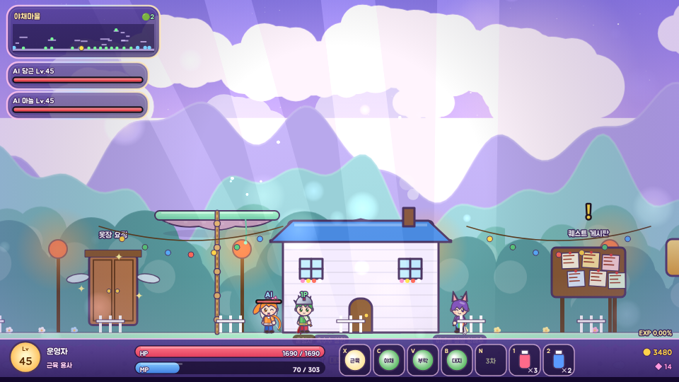

## 📈 레벨 · 능력치(AP)

- 만렙은 100입니다. 경험치 곡선은 Lv.10까지 빠르고, Lv.30까지 완만하며, Lv.50부터 어려워지고, **Lv.70부터는 거의 오르지 않습니다**.
- 레벨업마다 AP 5를 받고, **O 키**로 분배합니다. 주 능력치에 투자할수록 공격 배율이 오르고, 엉뚱한 능력치에 몰아 찍으면 약해집니다(약 ×0.5 ~ ×1.12).
  - STR: 최대 HP
  - INT: 최대 MP
  - LUK · DEX: 크리티컬 확률
  - 자동 분배는 주 능력치 4 : 보조 능력치 1 비율로 찍습니다.
- AP 초기화 주문서는 숨은 주문서 상인이 팝니다.

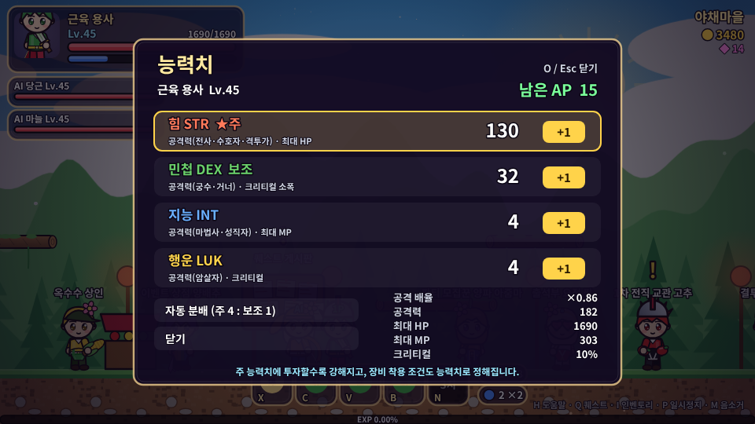

## 🗡 장비

- 슬롯은 **오른손(무기) · 왼손(보조) · 방어구 · 장신구 1~4**입니다.
- **양손무기**(양손검 · 활 · 총 · 스태프)를 끼면 왼손 장비가 자동으로 해제됩니다.
- **직업마다 쓸 수 있는 무기 종류가 정해져 있습니다.** 궁수는 활, 거너는 총만 쓸 수 있습니다.
- 장비마다 **레벨과 능력치(STR/DEX/INT/LUK) 착용 조건**이 있습니다.
- 등급은 일반 · 희귀 · 영웅 · 전설 · 신화입니다. 등급이 높을수록 드랍률이 낮고(전설 1~2.5%), **최고 성능은 퀘스트 보상 전용**입니다.

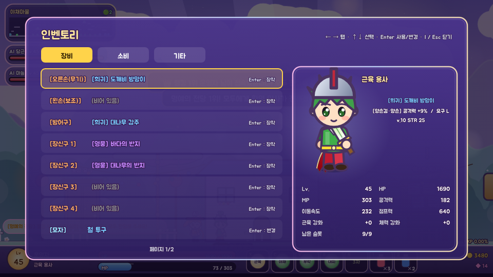
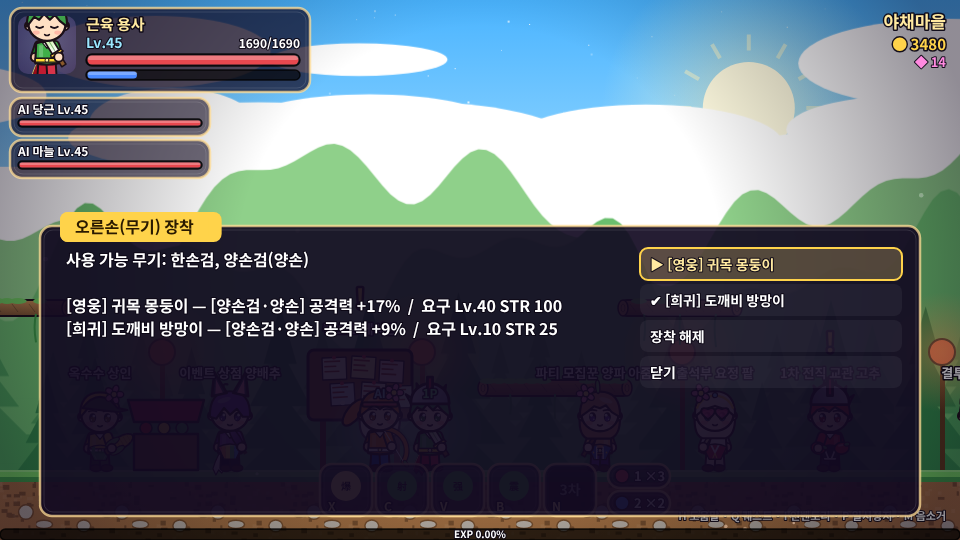

## 🪨 비석의 길 — 옴니버스 스토리 던전 (Lv.15+)

마을 오른쪽 끝 포탈이나 포탈 지기 스님에게서 들어갑니다. 비석마다 서로 다른 단편 이야기가 하나씩 담겨 있습니다.

| 화 | 제목 | 권장 Lv | 지역 · 던전 · 결말 보스 |
|---|---|---|---|
| 1 | 시금치 등대지기 | 15 | 파도 절벽 등대 · 등대 지하 창고 · 물귀신 대왕 |
| 2 | 대나무숲의 거짓말 | 25 | 속삭이는 대숲 · 거짓말이 자라는 숲속 · 거짓말 여우 |
| 3 | 얼어붙은 장터 | 35 | 눈 그치지 않는 장터 · 얼음 골목 · 서리 달걀 대왕 |
| 4 | 종이탈 무도회 | 50 | 탈춤 마당 · 가면 창고 · 말뚝이 탈 도깨비 |
| 5 | 막차, 저승행 | 60 | 자정의 정류장 · 막차 뒤칸 · 저승 차사 구미호 |
| 6 | 순무, 첫 번째 이름 | 75 | 이름 없는 언덕 · 이야기의 조각들 · 이름 없는 귀목 |

- 각 화는 **점프맵 → 던전(3웨이브) → 결말 보스** 순서로 진행합니다.
- **던전 2회 클리어 + 결말 보스 처치**로 비석 균열이 3/3이 되면 "**제N화의 비석이 뚫렸습니다!**"가 뜨고 다음 화가 열립니다.
- 화마다 퀘스트 4개(프롤로그 · 던전 · 사이드 · 결말)가 있고, 에필로그가 하나 더 있습니다. 레터박스 컷신과 타자기 효과 대사로 진행합니다.
- 결말 퀘스트 보상은 그 이야기의 **기억 장신구**(전설~신화, 퀘스트 전용)입니다.

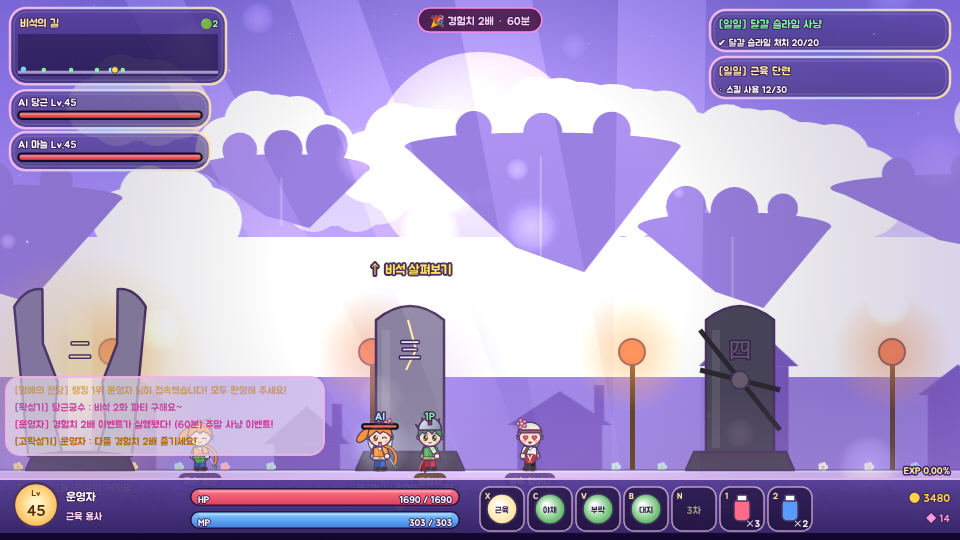
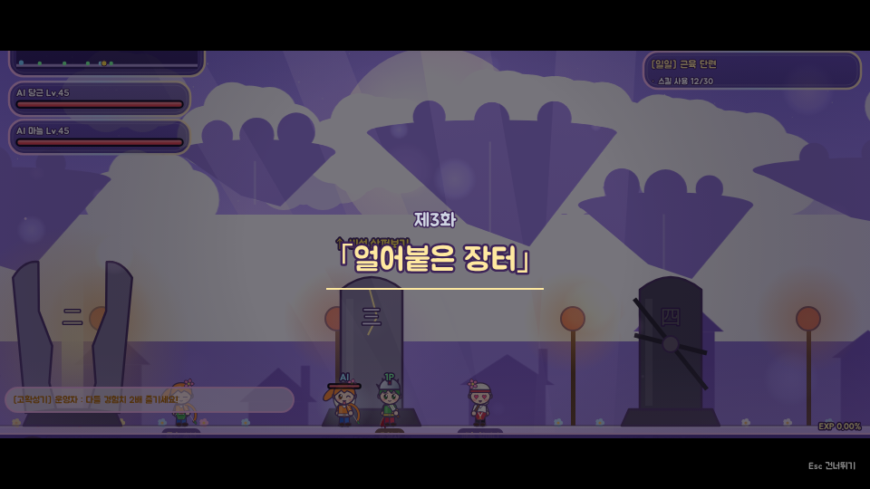

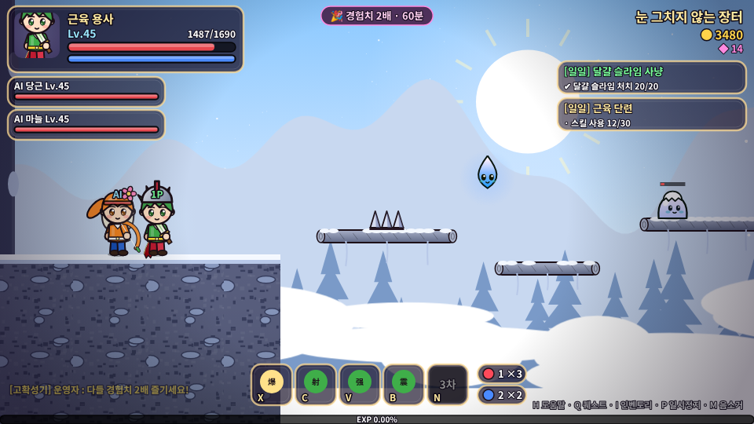
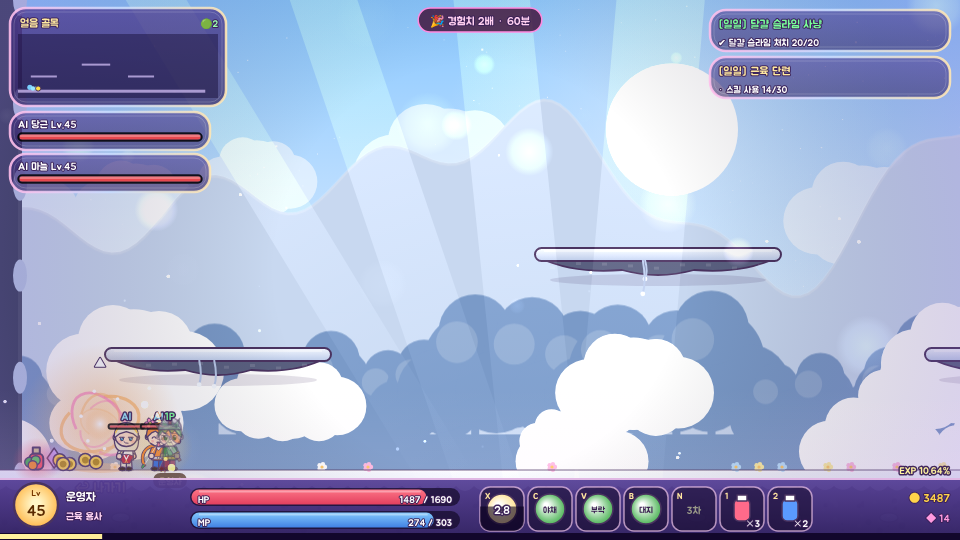
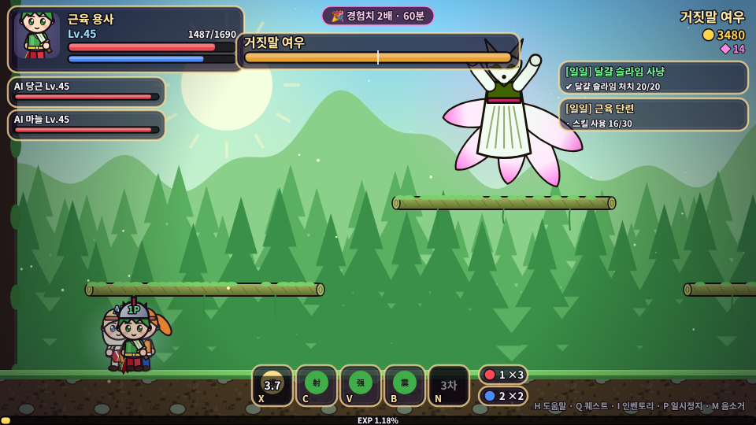

## 💬 채팅 · 확성기 · 🎉 운영자 이벤트

- **Enter**로 채팅창을 엽니다.
  - 일반: 같은 맵의 유저에게만 보입니다.
  - **확성기**(300●): 전체 채팅입니다.
  - **고확성기**(◆2): 전체 채팅에 더해 화면 상단에 무지개 알림이 뜹니다.
- **운영자 이벤트**: 서버 환경변수 `ADMIN_NAMES`에 등록한 계정으로 로그인한 뒤 채팅에 `/운영`을 입력하면 이벤트 패널이 열립니다.
  - 고를 수 있는 이벤트: 경험치 2배·3배, 드롭률 2배, 이벤트 종료
  - 이벤트를 열면 접속 중인 모든 유저에게 "🎉 경험치 2배 이벤트가 실행됐다!"가 뜨고 즉시 적용됩니다. 화면 상단에는 남은 시간이 표시됩니다.

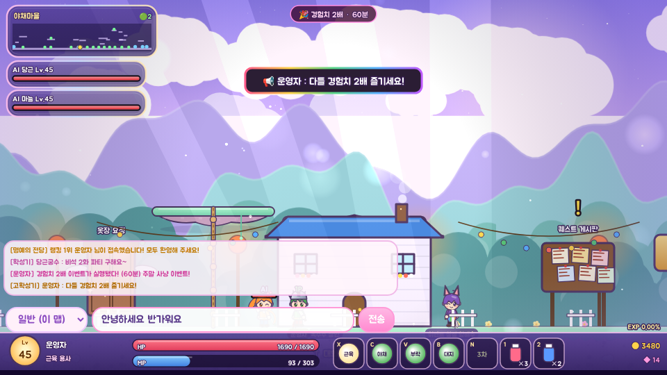

## 🌋 파티던전 · 👹 보스 · 🏔 점프맵

- 귀문 동굴(Lv.40+)의 용암 점프맵을 끝까지 갑니다.
- 수문장 퀘스트로만 만들 수 있는 소환템 **귀안**을 준비합니다. 재료인 금이빨 드랍률은 20%입니다.
- 제단에 귀안을 바쳐 **천년 귀목**을 소환합니다. 팔 8개를 먼저 부숴야 본체에 피해가 들어갑니다.

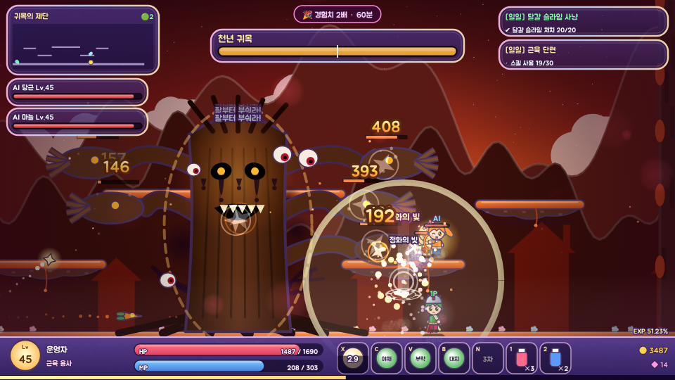
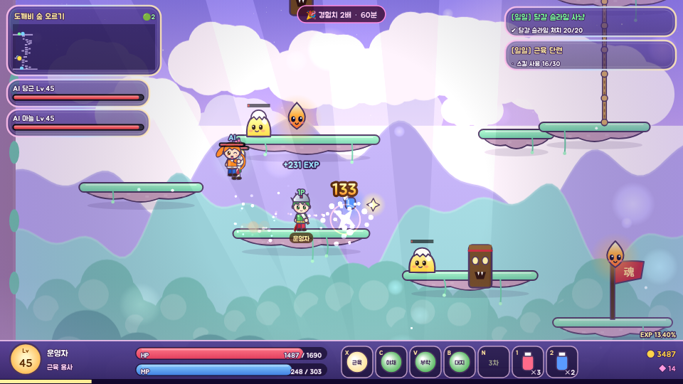
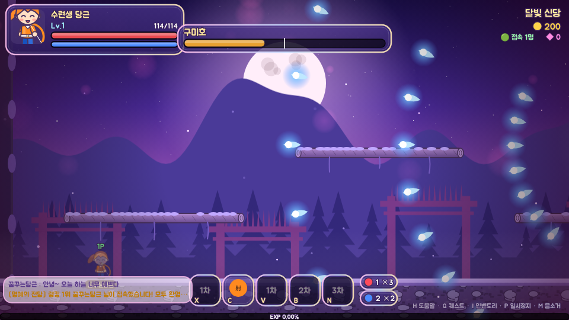

## ⚔️ PvP — 낙사 결투장

1P vs 2P(로컬) 또는 AI 도전자와 싸웁니다. 많이 맞을수록, 체력이 적을수록 **더 멀리 밀려나고**, 섬 밖으로 떨어지면 상대가 1점을 얻습니다. 3점을 먼저 따면 이깁니다.

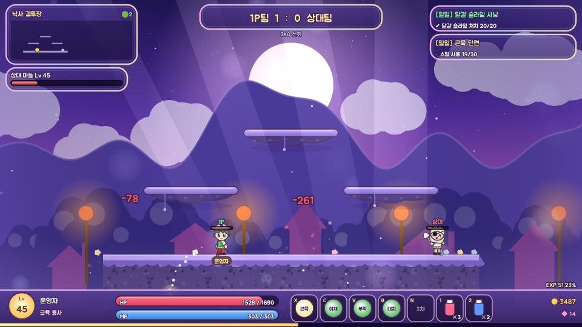

## 📅 일일퀘스트 · 출석 · 캐시 상점 · 주문서

- **일일퀘스트** 5종은 매일 자정에 초기화됩니다. 보상은 현재 레벨 필요 경험치의 %이고, 올클리어하면 보너스와 ◆2를 받습니다.
- **출석부**: 매일 이벤트 코인 ◆를 받고, 7일 연속 출석하면 캐시 치장템을 받습니다. 하루라도 빠지면 연속 출석이 처음부터입니다.
- **이벤트 상점**: 캐시 치장템은 ◆로만 살 수 있습니다.
- **숨은 주문서 상인**: 마을 밧줄 위에 숨어 있습니다. 근육·체력 주문서(100/60/30/10%), 순백의 주문서, AP 초기화 주문서를 팝니다.

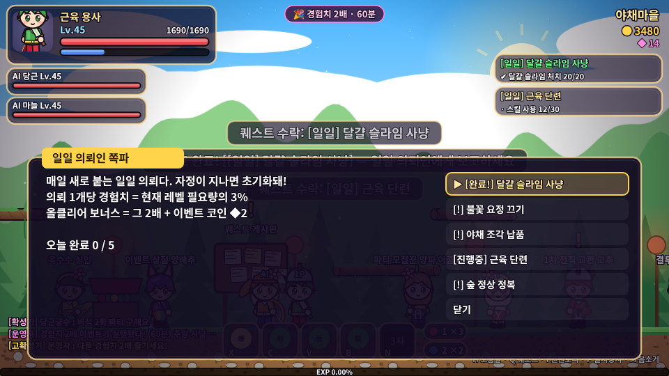
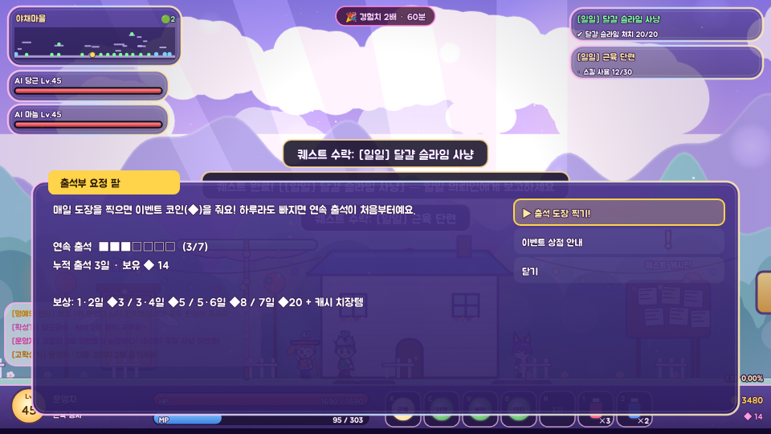
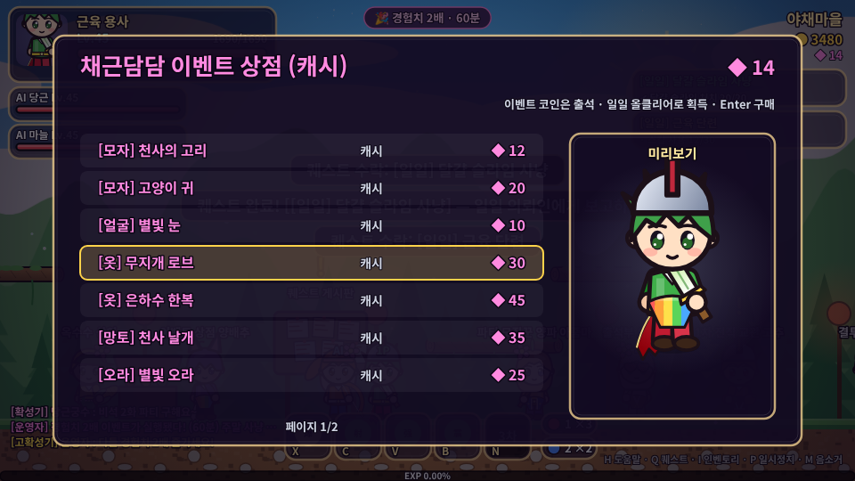
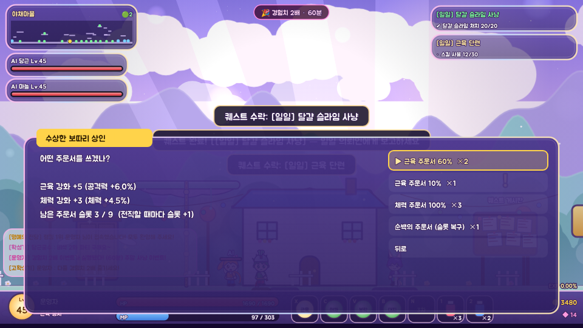
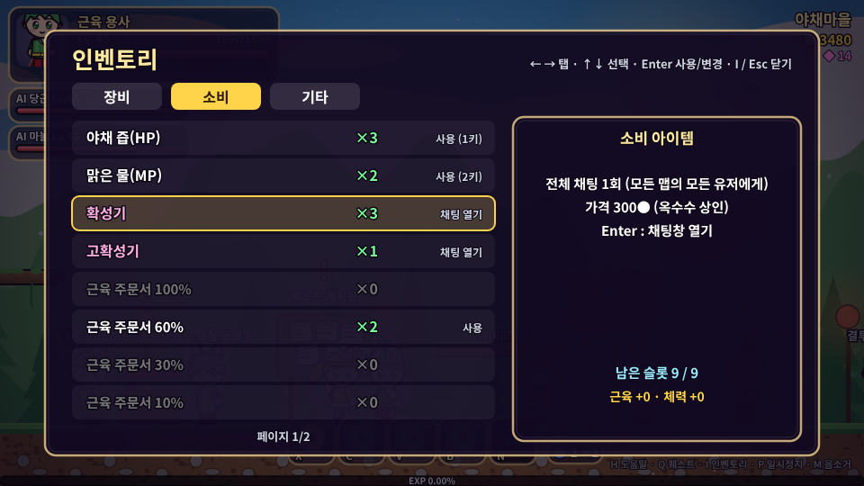

## 💾 계정

타이틀 화면의 **로그인 / 회원가입**에서 이름과 비밀번호만 입력하면 됩니다.
- 비밀번호는 scrypt와 솔트로 해시해 저장합니다. 원문은 저장하지 않습니다.
- 로그인 토큰은 HMAC으로 서명하고 30일간 유효합니다.
- 게스트로 플레이하던 기록은 가입할 때 계정으로 자동 이전됩니다.

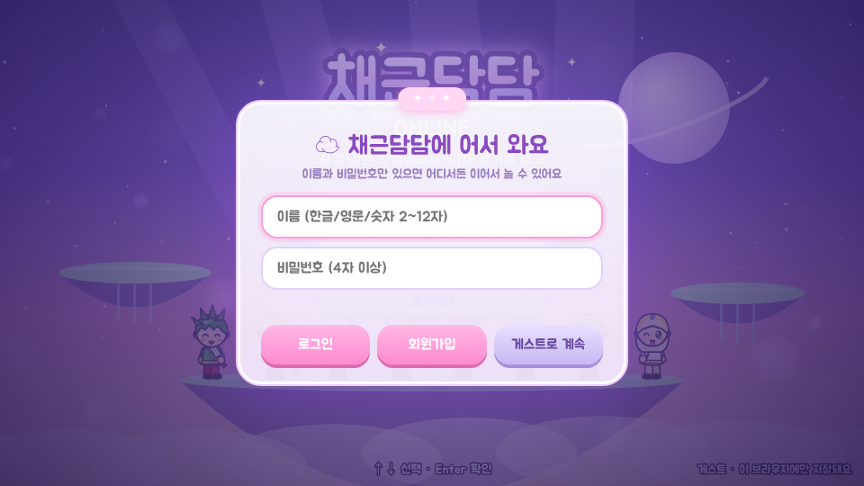

## 🛠 개발

```bash
./build.sh            # parts/*.js → 단일 index.html (+ 문법 검사)
npm install
npm start             # DATABASE_URL 없으면 data/db.json 파일 DB
npm run test:server   # 계정 · 저장 · 채팅 · 이벤트 API 테스트
pip install playwright && python3 tests/test_story_social.py   # 게임 시뮬레이션 테스트
```

| 파일 | 내용 |
|---|---|
| `parts/01_core.js` | 입력 · WebAudio 사운드/BGM · 파티클 |
| `parts/02_art.js`, `04_art2.js` | 2등신 캐릭터 · 야채 무기 · 몬스터 · 배경 · 치장 (모두 벡터 드로잉) |
| `parts/03_data.js` | 직업 · 스킬 · 장비/무기 규칙 · 퀘스트 · 경험치 곡선 · 계정 클라이언트 |
| `parts/05_world.js` | 마을 · 점프맵 · 보스방 · 파티퀘스트 · 파티던전 · PvP |
| `parts/06_entities.js` | 전투 · 스킬 · 몬스터 · PvP · AI 동료 |
| `parts/07_boss.js` | 보스 패턴 (제너레이터 스크립트) |
| `parts/08_ui.js` | 퀘스트 · 대화 · 상점 · 인벤토리 · 출석 · 주문서 · HUD |
| `parts/09_main.js` | 게임 루프 · 맵 로딩 · 렌더 |
| `parts/10_story.js` | 비석의 길 6화: 맵 생성 · 퀘스트 · 컷신 대본 · 던전 웨이브 · 비석 |
| `parts/11_social.js` | AP · 장비 착용 규칙 · 채팅/확성기 · 운영자 이벤트 |
| `parts/12_extra.js` | 표정 20종 · 새싹 항구 · 명예의 전당/랭커 환영 · 확대 방지 |
| `server/` | Express API (계정 · 저장 · 채팅 · 이벤트 · 랭킹) + Postgres/파일 DB |

### ☁️ 배포: Render(웹) + Neon(무료 Postgres)

1. **Neon**에서 프로젝트를 만들고 연결 문자열(`postgresql://…?sslmode=require`)을 복사합니다. 테이블은 서버가 처음 실행될 때 자동으로 만듭니다.
2. **Render**에서 **New → Blueprint**를 누르고 이 저장소를 선택합니다. `render.yaml`이 Node 웹 서비스로 설정합니다.
3. Render Environment에 아래 값을 넣습니다.
   - `DATABASE_URL` = Neon 연결 문자열
   - `ADMIN_NAMES` = 운영자 게임 이름 (쉼표로 여러 명)
   - `SECRET`은 Blueprint가 자동으로 생성합니다.
4. `main`에 푸시하면 자동 배포됩니다. `/api/health`에서 `"db":"postgres"`가 나오면 정상입니다.

> 무료 플랜은 유휴 후 첫 접속이 느릴 수 있습니다. 채팅은 서버 메모리에 최근 300개까지만 보관하고, 이벤트는 DB에 저장합니다.

## 알려진 한계

- 실시간 위치 동기화 멀티플레이는 없습니다. 채팅·이벤트·저장만 서버를 거치고, 파티는 로컬 2P와 AI 동료로 대체합니다.
- 저장 데이터와 확성기 개수는 클라이언트가 보내는 값이라 변조를 막지 않습니다(캐주얼 용도).
